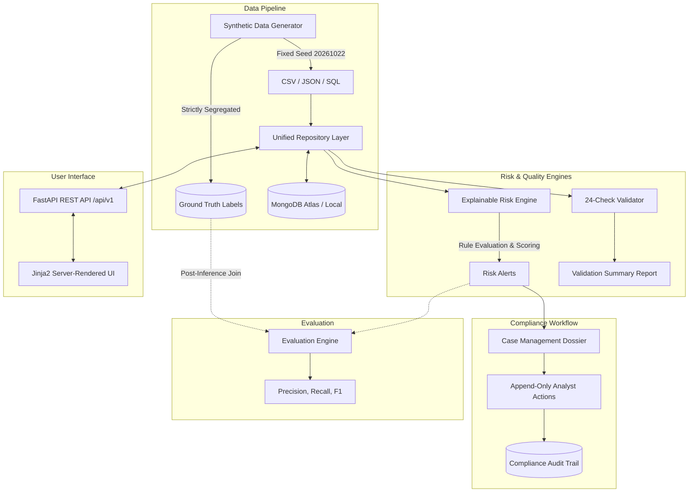

# SentinelIQ — Intelligent Transaction Risk & Investigation Platform
> **Explainable Risk. Traceable Decisions.**

[](https://www.python.org/)
[](https://fastapi.tiangolo.com/)
[](https://www.mongodb.com/atlas)
[]()
[]()

[](https://render.com/deploy?repo=https://github.com/ajayreddy510/sentineliq)
[](https://vercel.com/new/clone?repository-url=https://github.com/ajayreddy510/sentineliq)

SentinelIQ is a production-minded, end-to-end financial transaction monitoring, risk scoring, referential integrity validation, and case investigation platform built for the **YottaFlex.ai Associate AI Forward Deployed Engineer — 72 Hours Code Challenge**.

---

## 1. Project Identity & Branding

- **Product Name:** SentinelIQ
- **Full Name:** SentinelIQ — Intelligent Transaction Risk & Investigation Platform
- **Tagline:** Explainable Risk. Traceable Decisions.
- **Repository Name:** `sentineliq-risk-intelligence`
- **Application Title:** `SentinelIQ | Transaction Risk Intelligence`
- **API Title:** `SentinelIQ API`
- **Documentation Title:** `SentinelIQ — Technical Documentation`

---

## 2. Project Overview

Modern financial compliance teams face a dual crisis: opaque black-box scoring systems that lack explainability, and brittle rule lists that fail referential integrity and audit scrutiny. 

SentinelIQ bridges this divide with:
1. **Deterministic Synthetic Ledger Generation:** Reproducible scale generation up to 100,000 transactions and 1,000 alerts with zero personal data.
2. **Transparent, Multi-Signal Rules Engine:** 12 configurable rules across integrity, value, velocity, behavioral, and compliance dimensions.
3. **Audit-Proof Explainability:** Narrative explanations, standard reason codes, and runtime evidence snapshots for every alert.
4. **End-to-End Case Investigation Dossiers:** Case lifecycles, analyst action timelines, and compliance dispositions.
5. **Post-Inference Evaluation:** Ground truth is strictly isolated from inference inputs and joined only during evaluation to calculate Precision, Recall, F1, Specificity, and Accuracy.
6. **24-Check Validation Suite:** Full structural, referential, chronological, and anti-leakage integrity checks.

---

## 3. Problem Statement

Financial crime compliance systems must reconcile conflicting demands:
- **High throughput:** Processing tens of thousands of ledger events per second.
- **Explainability:** Regulators (e.g. FinCEN, FCA, MAS) require financial institutions to articulate exactly why an alert was triggered.
- **Data Integrity:** Orphaned records, closed-account postings, overdraft breaches, and transfer mismatches erode trust.
- **Traceability:** Every decision by human investigators must be permanently auditable.

---

## 4. Key Features

- **Real Database Persistence:** Direct MongoDB Atlas integration with replica set support and explicit indexing, accompanied by an in-memory cache for offline/sandbox test execution.
- **Strict Ground Truth Separation:** Zero label leakage. Input transactions do not contain target labels.
- **Deterministic Checksum Reproducibility:** Fixed random seed `20261022` produces bitwise-identical CSV, JSON, and SQL export checksums across runs.
- **Relational SQL Compatible Export:** Recreates the document model into a relational schema complete with DDL tables, foreign keys, and typed insert statements.
- **Server-Rendered Responsive UI:** 11 server-rendered pages using Jinja2 templates and a slate/navy design system with zero external CDN dependencies.
- **Role-Based Access Control:** Distinct roles for `ADMIN`, `ANALYST`, `COMPLIANCE_REVIEWER`, and `READ_ONLY`.

---

## 5. System Architecture



For comprehensive architectural design, see [docs/architecture.md](docs/architecture.md).

---

## 6. Technology Stack

- **Core Programming Language:** Python 3.10+
- **Backend & REST API:** FastAPI 0.162, Uvicorn 0.32, Pydantic v2, Pydantic-Settings
- **Data Engineering:** NumPy 2.2, Pandas 2.3
- **Database:** MongoDB Atlas, PyMongo 4.17
- **Security & Crypto:** native `bcrypt`, `python-jose` (HMAC-SHA256)
- **Frontend:** Jinja2 3.1 Server-Rendered Templates, Modern Vanilla CSS, minimal vanilla JavaScript
- **Quality Assurance:** Pytest 9.1, HTTPX 0.28
- **Hosting Targets:** Render (FastAPI backend), Vercel (Python serverless frontend), MongoDB Atlas (Data persistence)

---

## 7. Repository Structure

```
sentineliq-risk-intelligence/
├── backend/
│   ├── app/
│   │   ├── main.py               # Main FastAPI application entrypoint & lifespan
│   │   ├── config.py             # Centralized Pydantic settings & environment
│   │   ├── api/v1/               # Versioned REST API routers
│   │   │   ├── auth.py           # Authentication & token endpoints
│   │   │   ├── metrics.py        # Database-backed operational metrics
│   │   │   ├── customers.py      # Customers and accounts endpoints
│   │   │   ├── transactions.py   # Ledger transactions endpoints
│   │   │   ├── alerts.py         # Risk alerts & evidence endpoints
│   │   │   ├── cases.py          # Investigation cases & actions endpoints
│   │   │   ├── rules.py          # Configurable risk rules & testing
│   │   │   └── operations.py     # Generation, validation, evaluation & exports
│   │   ├── database/             # MongoDB connectivity, indexes & repository
│   │   ├── models/               # Domain Pydantic models (Customer, Account, etc.)
│   │   └── security/             # Password hashing, JWT & role permissions
├── frontend/
│   ├── app.py                    # Standalone ASGI serverless app for Vercel
│   ├── routes.py                 # 11 server-rendered Jinja2 HTML routes
│   ├── templates/                # Responsive HTML pages
│   └── static/                   # CSS design system & client JS
├── generator/
│   ├── generate.py               # CLI generator orchestrator
│   ├── entity_factories.py       # Deterministic entity generators
│   └── scenario_injector.py      # Negative scenarios & ground truth injection
├── risk_engine/
│   ├── engine.py                 # Core detection engine
│   ├── rules.py                  # 12 rule specifications & configurations
│   ├── scoring.py                # 0-100 scoring & severity banding
│   └── explainability.py         # Narrative explanations & evidence generator
├── validation/
│   └── checks.py                 # 24-check integrity validation suite
├── evaluation/
│   └── evaluator.py              # Confusion matrix, Precision, Recall, F1
├── scripts/
│   ├── verify_reproducibility.py # Double-run seed comparison script
│   └── seed_database.py          # MongoDB Atlas seeder script
├── tests/                        # 33 unit, integration, negative scenario & e2e tests
├── exports/                      # Generated CSV, JSON, SQL & manifest
├── ground_truth/                 # Strictly isolated benchmark labels
├── reports/                      # Validation, evaluation & checksum summaries
├── docs/                         # In-depth technical architecture documentation
├── .env.example                  # Environment configuration template
├── pyproject.toml                # Project packaging configuration
├── requirements.txt              # Production deployment dependencies
├── render.yaml                   # Infrastructure-as-Code for Render
└── vercel.json                   # Vercel serverless deployment specification
```

---

## 8. Data Model Overview

SentinelIQ enforces domain entity structures using stable, readable identifiers:
- **Customers (`CUS-000001`):** Legal KYC profile, type, risk tier, status.
- **Accounts (`ACC-CUS-000001-01`):** Balance, currency, overdraft limit, opened/closed dates.
- **Merchants (`MER-00001`):** Category code, risk level, country.
- **Devices (`DEV-000001`):** SHA-256 fingerprint, device type, OS, IP country, status.
- **Transactions (`TXN-2026-00000001`):** Amount, currency, channel, balances, transfer group.
- **Transfer Links (`TRL-2026-00000001`):** Reciprocal debit and credit leg relationship.
- **Alerts (`ALT-2026-000001`):** Score, severity, triggered rules, evidence, narrative.
- **Cases (`CASE-2026-000001`):** Investigation status, priority, analyst, disposition.
- **Analyst Actions (`ACT-2026-000001`):** Append-only audit note or disposition change.

For field definitions, see [docs/data_dictionary.md](docs/data_dictionary.md).

---

## 9. Synthetic Dataset Volumes

| Entity | Demo Profile | Full Profile Baseline | Actual Generated (Full) |
|---|---:|---:|---:|
| Customers | 100 | 5,000 | **5,000** |
| Accounts | 150 | 7,000 | **7,000** |
| Transactions | 2,000 | 100,000 | **100,000** |
| Alerts | 25 | 1,000 | **1,000** |
| Investigation Cases | 15 | 500 | **500** |
| Merchants | 40 | 500 | **500** |
| Devices | 100 | 3,000 | **3,000** |
| Transfer Links | ~150 | ~5,000 | **5,000** |

---

## 10. Data Generation Instructions

Generate the deterministic synthetic dataset with one canonical command:

```bash
# Demo profile (fast, for local testing)
python -m generator.generate --profile demo --seed 20261022

# Full challenge profile (100,000 transactions, 1,000 alerts)
python -m generator.generate --profile full --seed 20261022
```

Outputs are written to `./exports/`, `./ground_truth/`, and `./reports/`.

---

## 11. Fixed Seed & Reproducibility

The default execution seed is fixed to:
`20261022`

All pseudo-random selections (customer demographics, account linkages, timestamps, device fingerprints, transaction amounts, and scenario allocations) are keyed to this seed. Running the generator with seed `20261022` produces byte-for-byte identical output files.

---

## 12. Ground-Truth Separation

Ground-truth files (`ground_truth/ground_truth.json` and `ground_truth/ground_truth.csv`) are generated and stored separately.
- Transactions do **not** contain `is_suspicious` or any target labels.
- The Risk Detection Engine has **zero access** to ground-truth labels.
- Post-inference evaluation joins detection alerts to ground-truth records by `transaction_id`.
- Test suite validates this isolation programmatically (`test_ground_truth_isolation.py`).

For full details, see [docs/evaluation.md](docs/evaluation.md).

---

## 13. Risk Rules & Scoring

SentinelIQ implements 12 rules:
1. `RULE-CLOSED-ACCOUNT`: Transaction posted against closed account.
2. `RULE-OVERDRAFT-EXCEEDED`: Negative balance breaches authorized overdraft.
3. `RULE-TRANSFER-MISMATCH`: Mismatched amount or currency between transfer legs.
4. `RULE-ALERT-NO-TXN`: Data integrity fault — alert lacks triggering transaction.
5. `RULE-CASE-CHRONOLOGY`: Chronological integrity fault — disposition precedes alert.
6. `RULE-HIGH-VALUE`: Single transaction amount $\ge \$10,000$.
7. `RULE-VELOCITY`: $>5$ transactions within 1 hour.
8. `RULE-NEW-DEVICE`: Transaction from untrusted/flagged hardware device.
9. `RULE-DORMANT-REACTIVATION`: Sudden $>\$1,000$ transaction on account inactive 90+ days.
10. `RULE-CIRCULAR-TRANSFER`: Circular fund layering between accounts.
11. `RULE-UNUSUAL-MERCHANT`: High-risk category exposure (Gambling, Crypto).
12. `RULE-MULTI-SIGNAL`: Compound risk aggregating 3+ concurrent violations.

Deterministic Score Formula:
$$\text{Score} = \min\left(100.0, \, \max(W) + 0.35 \times \sum_{i > 1} W_i\right)$$

For parameter thresholds and scoring weights, see [docs/risk_rules.md](docs/risk_rules.md).

---

## 14. Validation Checks

The validation engine runs 24 checks across all entities:
- Identifier uniqueness
- Foreign key references (Customer, Account, Merchant, Device)
- The 5 mandatory negative scenario checks
- Positive amount and currency formatting constraints
- Chronological ordering constraints
- Anti-leakage check (ensuring no ground truth appears in transactions)
- Export manifest consistency

Validation produces machine-readable `reports/validation_summary.json`.

---

## 15. Evaluation Methodology

Detection quality metrics are computed strictly post-inference:
- **Precision:** $TP / (TP + FP)$
- **Recall:** $TP / (TP + FN)$
- **F1 Score:** $2 \times (\text{Precision} \times \text{Recall}) / (\text{Precision} + \text{Recall})$
- **Specificity:** $TN / (TN + FP)$
- **Accuracy:** $(TP + TN) / \text{Scope}$

Baseline Results on Seed `20261022` (Full Profile):
- **Precision:** 68.75%
- **Recall:** 78.94%
- **F1 Score:** 73.49%
- **Specificity:** 99.68%
- **Accuracy:** 99.47%

---

## 16. API Endpoint Overview

All routes are versioned under `/api/v1`:
- `GET /health` & `GET /health/ready`
- `POST /api/v1/auth/login` & `GET /api/v1/auth/me`
- `GET /api/v1/metrics/overview`, `alerts`, `cases`, `data-quality`, `evaluation/summary`
- `GET /api/v1/customers`, `accounts`, `transactions`, `alerts`, `cases`, `rules`, `audit`
- `PATCH /api/v1/alerts/{id}/status`
- `POST /api/v1/cases` & `POST /api/v1/cases/{id}/actions` & `POST /api/v1/cases/{id}/disposition`
- `PATCH /api/v1/rules/{id}` & `POST /api/v1/rules/{id}/test`
- `GET /api/v1/exports/{filename}`

For request/response schemas, see [docs/api.md](docs/api.md).

---

## 17. Local Installation Instructions

### Prerequisites
- Python 3.10+
- Git

### Step-by-Step Setup
```bash
# 1. Clone the repository
git clone https://github.com/your-username/sentineliq-risk-intelligence.git
cd sentineliq-risk-intelligence

# 2. Create virtual environment
python -m venv venv
# On Windows:
.\venv\Scripts\activate
# On Linux/macOS:
source venv/bin/activate

# 3. Install dependencies
pip install -r requirements.txt

# 4. Initialize environment file
cp .env.example .env
```

---

## 18. Environment Variable Configuration

Configure `.env` (or use `.env.example` defaults for local offline mode):

```ini
APP_ENV=development
APP_STORAGE=memory       # Use 'mongodb' for MongoDB Atlas / Local MongoDB
MONGODB_URI=mongodb://localhost:27017
MONGODB_DATABASE=sentineliq_risk_intelligence
SECRET_KEY=sentineliq-default-dev-secret-key-32-bytes-change-in-prod-2026
ENABLE_DEMO_USERS=true
FRONTEND_BASE_URL=http://localhost:8000
API_BASE_URL=http://localhost:8000/api/v1
CORS_ORIGINS=["http://localhost:8000","http://127.0.0.1:8000"]
DEFAULT_SEED=20261022
DEFAULT_PROFILE=demo
```

---

## 19. MongoDB Atlas Setup

1. Create a free M0 cluster on [MongoDB Atlas](https://cloud.mongodb.com).
2. Create a database user with read/write permissions.
3. Whitelist your client IP under Network Access.
4. Set `MONGODB_URI` in `.env` to your Atlas connection string and set `APP_STORAGE=mongodb`.
5. Run the idempotent database seeder:
   ```bash
   python -m scripts.seed_database
   ```

---

## 20. Demo Account Configuration

For technical demonstration and challenge review, pre-provisioned demo accounts are available when `ENABLE_DEMO_USERS=true`:

| Role | Username | Password | Permitted Capabilities |
|---|---|---|---|
| **ADMIN** | `admin` | `SentinelIQ@Admin2026!` | Full configuration, rule updates, generation, audits |
| **ANALYST** | `analyst` | `SentinelIQ@Analyst2026!` | Alert investigation, case notes, status transitions |
| **COMPLIANCE** | `compliance` | `SentinelIQ@Compliance2026!` | Final dispositions, audits, regulatory review |
| **READ ONLY** | `readonly` | `SentinelIQ@ReadOnly2026!` | Read-only inspection; modifications rejected |

---

## 21. Running the Backend

Launch the unified FastAPI application:
```bash
python -m uvicorn backend.app.main:app --host 0.0.0.0 --port 8000 --reload
```
- API Docs: `http://localhost:8000/docs`
- Health: `http://localhost:8000/health`

---

## 22. Running the Frontend

The unified application serves both the REST API and the Jinja2 frontend at `http://localhost:8000`:
- **Login:** `http://localhost:8000/login`
- **Dashboard:** `http://localhost:8000/dashboard`
- **Transactions:** `http://localhost:8000/transactions`
- **Alerts Queue:** `http://localhost:8000/alerts`
- **Case Dossiers:** `http://localhost:8000/cases`
- **Data Quality:** `http://localhost:8000/validation`
- **Evaluation:** `http://localhost:8000/evaluation`
- **Exports & Generation:** `http://localhost:8000/generator`

---

## 23. Generating the Full Dataset

To generate the full challenge dataset:
```bash
python -m generator.generate --profile full --seed 20261022
```
Generates 5,000 customers, 7,000 accounts, 100,000 transactions, 1,000 alerts, and exports in ~4.5 seconds.

---

## 24. Running Tests

Run the complete test suite with Pytest:
```bash
python -m pytest
```
Output:
`33 passed, 1 warning in 2.42s`

---

## 25. Exporting CSV, JSON, and SQL

Exports are generated automatically during generation into `./exports/`:
- **CSV:** `customers.csv`, `accounts.csv`, `merchants.csv`, `devices.csv`, `transactions.csv`, `transfer_links.csv`, `risk_rules.csv`, `alerts.csv`, `cases.csv`, `analyst_actions.csv`, `audit_events.csv`
- **JSON:** One JSON export per entity collection.
- **Relational SQL:** `sentineliq_relational_export.sql` (complete DDL tables with primary keys, foreign keys, and insert statements).
- **Manifest:** `manifest.json` with entity counts and SHA-256 hashes.

---

## 26. Reproducibility & Checksum Comparison

SentinelIQ includes an automated verification script that generates the dataset twice with the same seed, calculates SHA-256 hashes, confirms 100% equality, and tests that altering the seed changes the output:

```bash
python -m scripts.verify_reproducibility --profile demo --seed 20261022
```

Verification Output:
```
Comparing SHA-256 Checksums for Identical Seed Runs:
[MATCH] customers.csv                    3917d77b91b21c2f... == 3917d77b91b21c2f...
[MATCH] accounts.csv                     7addddac436c6019... == 7addddac436c6019...
[MATCH] transactions.csv                 f90dd88a381107a9... == f90dd88a381107a9...
[MATCH] alerts.csv                       4c265fecf0c8d8ea... == 4c265fecf0c8d8ea...
[MATCH] sentineliq_relational_export.sql e2ae5202ad15cd03... == e2ae5202ad15cd03...
[PASS] Divergence confirmed: transactions.csv hash changed with seed 20262021.
REPRODUCIBILITY VERIFICATION PASSED: 100% Deterministic & Seed-Sensitive.
```

---

## 27. Deployment Instructions

SentinelIQ is configured for instant, automated deployment to both **Render** and **Vercel**:

### 1-Click Deploy Buttons
- **Render:** [](https://render.com/deploy?repo=https://github.com/ajayreddy510/sentineliq)
- **Vercel:** [](https://vercel.com/new/clone?repository-url=https://github.com/ajayreddy510/sentineliq)

### Render Deployment (Unified Web Service)
1. Go to [Render Dashboard](https://dashboard.render.com) and click **New +** &rarr; **Blueprint**.
2. Connect `https://github.com/ajayreddy510/sentineliq`.
3. Render automatically loads [`render.yaml`](render.yaml) and provisions the web service on the free tier.
4. (Optional) Provide `MONGODB_URI` in the Environment settings if connecting a MongoDB Atlas cluster.
5. Click **Apply Blueprint**.

### Vercel Deployment (Serverless ASGI Platform)
1. Go to [Vercel](https://vercel.com) and click **Add New...** &rarr; **Project**.
2. Import `ajayreddy510/sentineliq`.
3. Vercel automatically detects [`vercel.json`](vercel.json) and builds [`api/index.py`](api/index.py) using the Python serverless runtime.
4. Click **Deploy**. Vercel will output a live domain (e.g. `https://sentineliq.vercel.app`).

For detailed operational checklists, see [docs/deployment.md](docs/deployment.md).

---

## 28. Security Considerations

- Passwords hashed with `bcrypt` (12 rounds).
- Short-lived JWT tokens signed with SHA-256.
- Role-based authorization enforced server-side.
- Zero committed credentials or keys.
- Input validation on all entity fields via Pydantic v2.

For details, see [docs/security.md](docs/security.md).

---

## 29. Known Limitations

- **Vercel Serverless Limits:** Vercel functions cannot run long data generation tasks (>30s on free tiers). Generation should be run locally or triggered via Render.
- **SQL Import Memory:** The generated SQL relational export includes schema DDL and representative seed batches; full 100k-row inserts should be piped via bulk copy (`COPY` in PostgreSQL) for multi-gigabyte production loads.

---

## 30. Assumptions & Design Decisions

- **Currency Semantics:** The system assumes ledger amounts are in ISO currency codes (USD, EUR, GBP, CAD) and enforces 2-decimal precision.
- **Transfer Legs:** Transfers are modeled as linked reciprocal legs connected by a common `transfer_group_id` via `TransferLink`.
- **Explainability First:** Transparent rules with exact reason codes and evidence take precedence over uninterpretable black-box ML predictions.

---

## 31. Future Improvements

- Graph database integration (e.g. Neo4j) for deep multi-hop entity graph visualization.
- Automated regulatory SAR/STR e-filing XML export (FinCEN BSA format).
- Machine learning anomaly detection extension (e.g. Isolation Forest) as a supplementary feature layered over deterministic rules.

---

**SentinelIQ &bull; Explainable Risk. Traceable Decisions.**  
*Built for the YottaFlex.ai Associate AI Forward Deployed Engineer Code Challenge.*
