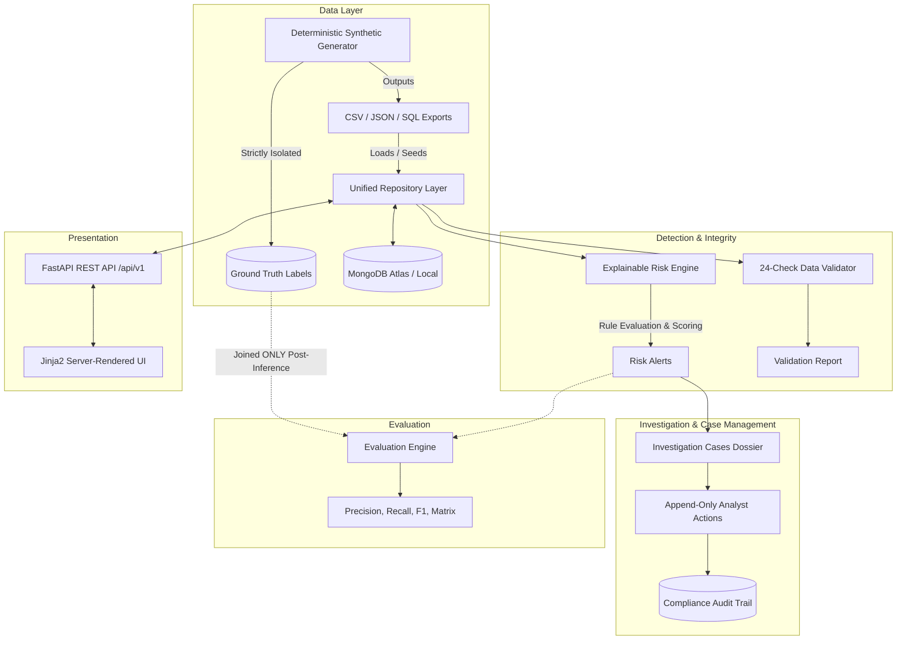

# SentinelIQ — System Architecture & Design
**Intelligent Transaction Risk & Investigation Platform**  
*Tagline: Explainable Risk. Traceable Decisions.*

---

## 1. Architectural Overview

SentinelIQ is built as a transparent, high-throughput financial crime transaction monitoring, risk scoring, and investigation case management platform. It combines a deterministic synthetic ledger generator, explainable risk detection engine, append-only analyst audit trail, referential validation suite, and post-inference evaluation framework.

---

## 2. Key Architecture Pillars

### 2.1 Complete Ground-Truth Isolation
Ground truth labels (`ground_truth/ground_truth.json`) are stored strictly outside the operational feature pipeline. The Risk Engine has **zero read access** to ground-truth labels during detection. Joining happens exclusively in post-inference evaluation to benchmark detection quality.

### 2.2 Dual-Tier Persistence
The repository layer supports:
- **MongoDB Atlas / Local MongoDB:** Production persistence with explicit compound and unique indexes on primary identifiers.
- **In-Memory Cache Mode:** Deterministic memory repository loaded from export artifacts, ensuring instant local testing, sandbox safety, and zero external runtime dependencies.

### 2.3 Transparent Explainability
Every generated alert includes:
1. Deterministic numeric score (0 to 100)
2. Severity classification band (`CRITICAL`, `HIGH`, `MEDIUM`, `LOW`)
3. List of triggered risk rule identifiers
4. Human-readable narrative explanation
5. Exact reason codes
6. Structured evidence dictionary containing runtime parameter deltas
7. Actionable recommended investigator procedures

### 2.4 Immutable Append-Only Audit Trail
No historical record, case transition, or analyst note can be modified or deleted. Every state change is serialized to `audit_events` with timestamp, actor ID, correlation ID, previous state, and new state.
